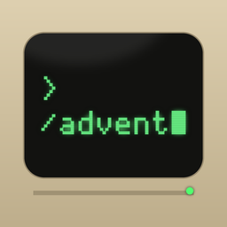
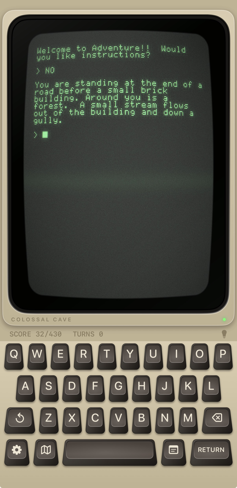
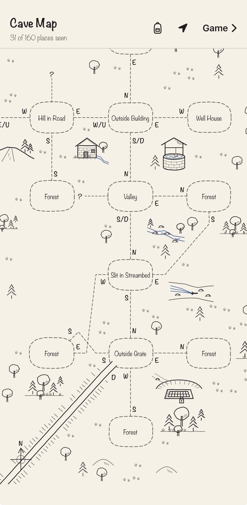
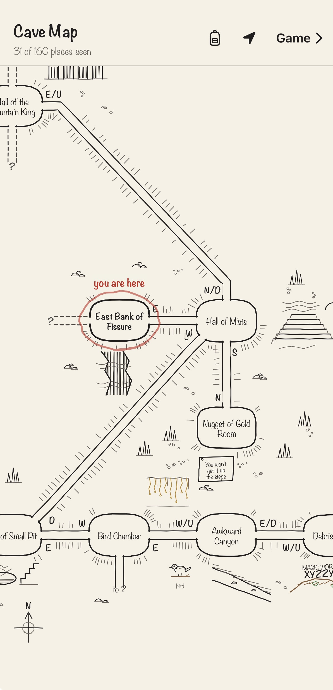
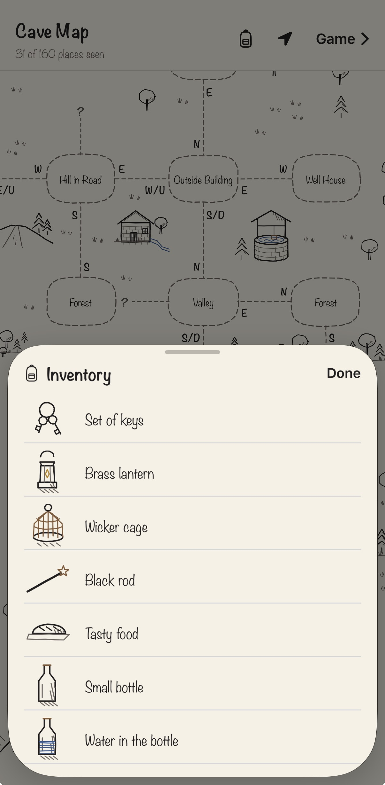
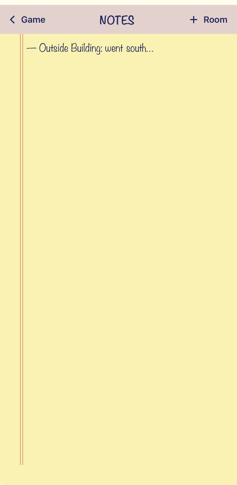
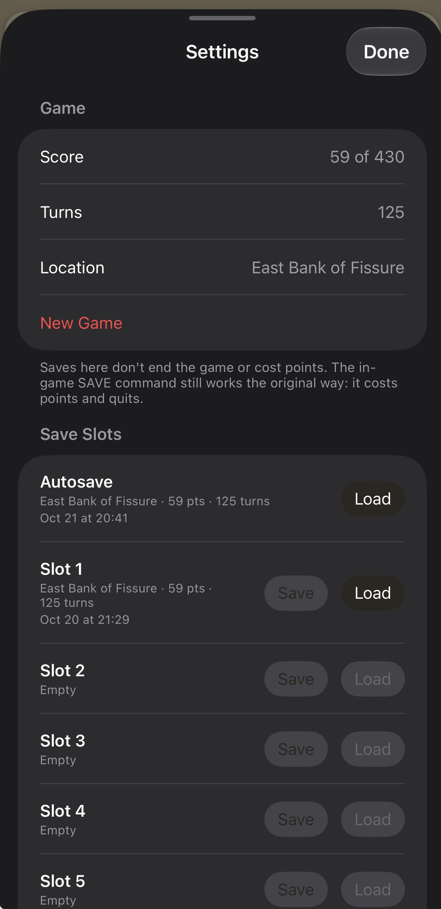
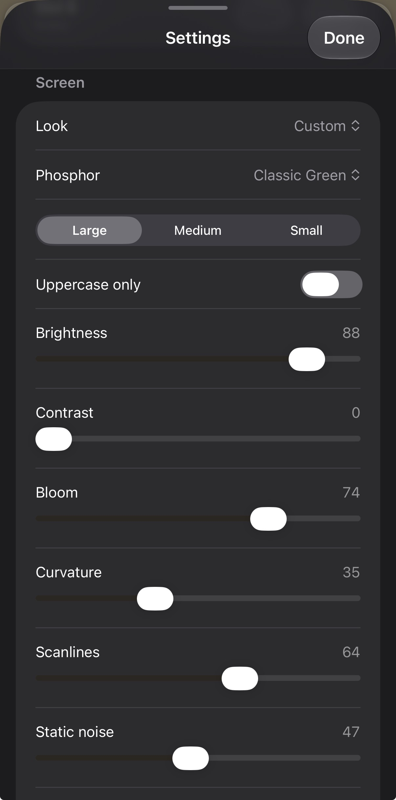

 /advent">


# Adventure for iOS

Colossal Cave Adventure on iPhone and iPad, styled as an early-80s home computer:
a phosphor monitor with real CRT effects on top, an Apple IIe-style keyboard below.

The game itself is **Open Adventure 1.22** (Eric S. Raymond's forward port of
Crowther & Woods' Adventure 2.5), compiled **unmodified** from upstream C.

## Screenshots

<p>
  
  
  
  
</p>
<p>
  
  
  
</p>

*The game · the map above ground and underground · the inventory · notes ·
save slots · screen settings.*

## Open and run

1. Open `OpenAdventure.xcodeproj` in Xcode (16 or newer; built for Xcode 27 / iOS 27).
2. Select the **OpenAdventure** target → *Signing & Capabilities* → choose your Team.
   Change the bundle id from `com.example.OpenAdventure` if you like.
3. Run on a simulator or device. Deployment target is iOS 18.

The app builds and runs on iPhone with Xcode 27. The game engine and the
map data are checked by automated tests (see *Tests*); the SwiftUI
interface has no automated tests, so it has been checked by hand on a
device.

## Using it

| | |
|---|---|
| **Swipe the monitor right** | Map |
| **Swipe the monitor left** | Notepad |
| **Drag the monitor up/down** | Scroll back through earlier text |
| **↺ key** | Previous command (press again to go further back) |
| **Map / Notes keys** (beside the space bar) | Open the map / the notepad |
| **Gear key** (bottom left) | Settings: save/load slots, new game, text size, screen look, controls |
| Hardware keyboard | Works on iPad / with a Bluetooth keyboard; arrows walk N/S/E/W, Tab recalls, Esc clears |

- **Map** is sketched in pen and ink, like an explorer's notebook: caves
  are chambers joined by tunnels with rock hatching along their walls, the
  surface is clearings joined by trails. Each passage leaves a room from the
  side matching its direction (north = top). Round every place is a sketch
  of what the game describes there (the locked grate, the snake, the
  dragon on its rug…) and the items lying there when the game starts, with
  rocks, trees or water round about. Beside each end of a passage is the command
  that takes you along it, the game's way — `N`, `NE`, `U`, `IN`, or `N/D`
  when both work, or a word like `climb` or `fly`. A pencilled chevron marks
  a one-way passage (only its starting end has a command). Dotted `?` stubs
  are exits you haven't followed; "to …" stubs are off-page connectors for
  passages that would otherwise cross the whole map. Only places you have
  *seen* (lit) appear, and the red-pencil ring is you.
  The **backpack** button at the top of the map lists what you're
  carrying, each thing sketched beside the game's own name for it.
  **Tap a room** to list all its exits with the exact commands — including
  the forest and the all-different maze, which are drawn as blocks of boxes
  because their paths are a deliberate tangle. Pinch to zoom, drag to pan,
  double-tap to re-center, swipe in from the right edge to return.
- **Notepad** saves to `Notes.txt`; `+ Room` drops in the current room name.
- **Saves**: six slots plus an autosave (written whenever the app leaves the
  foreground, and resumed on launch). Slot saves don't end the game or cost
  points. The in-game `SAVE` command still behaves as in 1977: it costs points
  and quits. All saves are in *Files → On My iPhone → Adventure → Saves* and
  are the same binary format as the desktop `advent -r`.
- **Screen settings**: presets (Classic, Amber Terminal, Green Scanlines,
  Paper White, Worn Out, Crisp) and sliders for brightness, contrast, bloom,
  curvature, scanlines, static, jitter, flicker, horizontal sync, glow line,
  color fringing and ambient glow. Text size Large (32 columns, default), Medium (40) or Small (80); uppercase-only mode.
  Reduce Motion pauses the moving effects.

## How it's built

```
Engine/upstream/   Open Adventure 1.22 C sources, untouched (+ generated dungeon.c/.h)
Engine/shim/       advent_override.h   redirects main/exit/stdout/isatty for iOS
                   advent_bridge.c/.h  runs the engine on a thread; C API for Swift
                   editline/readline.h stand-in for libedit (not on iOS)
Engine/wrap/       *_ios.c — each #includes the override header, then one upstream file
OpenAdventure/     SwiftUI app
  Engine/          GameEngine (bridge to Swift, transcript, input), SaveStore
  Terminal/        pixel font, 40/80-col layout, 280×192 / 560×192 bitmap renderer
  Monitor/         CRT.metal shader, CRTEffect, monitor bezel, settings model
  Keyboard/        Apple IIe-style keyboard
  Map/             CaveMap (generated layout) + MapView
  Notes/           NotepadView
  Settings/        SettingsView
Tools/             map generator + layout, make_xcodeproj.py, engine and map tests
```

**The engine bridge.** Upstream is a blocking terminal program. On iOS it
runs on its own thread; `readline()` (our stand-in) blocks until the app
submits a line, and hands Swift a snapshot of the player's location, the
rooms seen, score and turns. `exit()` ends only the engine thread.
`stdout` goes to a callback. No upstream file is edited, so updating to a
new Open Adventure release is: copy the new `.c/.h` files into
`Engine/upstream/`, regenerate `dungeon.c/.h` (below), run the tests.

**The screen** is drawn at the real machine's resolution (280×192 at 40
columns, 560×192 at 80) with an original 5×7 pixel font, then scaled with no
smoothing and passed through `CRT.metal` as a SwiftUI layer effect.

**The map** covers the 430-point game (Adventure 2.5): 160 places, including
the 2.5 additions such as the Ledge you reach by flying the rug. Every line and
exit is generated from the game's travel table (`Tools/mapdata.py`), so it
can't disagree with the engine. Only the room *positions*
(`Tools/map_layout.txt`) are a design choice: found with an annealing helper
(`solve_layout.py` + `layout_sa.c`) and then tuned by hand. `make_map.py`
checks them every run — currently no overlaps, no line through a box, no
compass exit drawn backwards, 14 line crossings in the whole cave.
The drawings are baked by `make_art.py` from `sketches.py` (one small
drawing function per scene and item) into `map_art.json`: each sketch is
placed once, for the whole cave, so nothing moves as the map fills in.

## Regenerating files

```sh
# dungeon tables (needs Python 3 + PyYAML), after updating upstream:
cd Tools && python3 make_dungeon.py && mv dungeon.c dungeon.h ../Engine/upstream/ && cd ..
# map (needs PyYAML; Pillow for the optional picture), after editing
# Tools/map_layout.txt or updating upstream:
python3 Tools/make_map.py --preview map.png
cd Tools && python3 make_art.py && cd ..   # the ink sketches (needs NumPy, Pillow)
# project file, after adding/removing source files:
python3 Tools/make_xcodeproj.py
```

## Tests

```sh
sh Tools/run_engine_tests.sh
```

Runs upstream's regression suite through the same bridge the app links:
105 passed, 0 failed, 2 skipped (the skipped two exercise `-l`/`-o` command-line
flags the app doesn't use). Then checks save → stop → new game → restore → quit,
and replays every test game's moves against the map (`check_map.py`): every
place the engine puts you has a box, and every move — about 13,000 of them —
is a drawn line or a listed exit.

## Credits & license

Adventure by Will Crowther (1976) and Don Woods (1977–1995). Open Adventure
by Eric S. Raymond and contributors, BSD 2-Clause — see
`Engine/upstream/COPYING`; the license is also shown in the app's About screen.
The pixel font, CRT shader, map and UI in this project are original.
